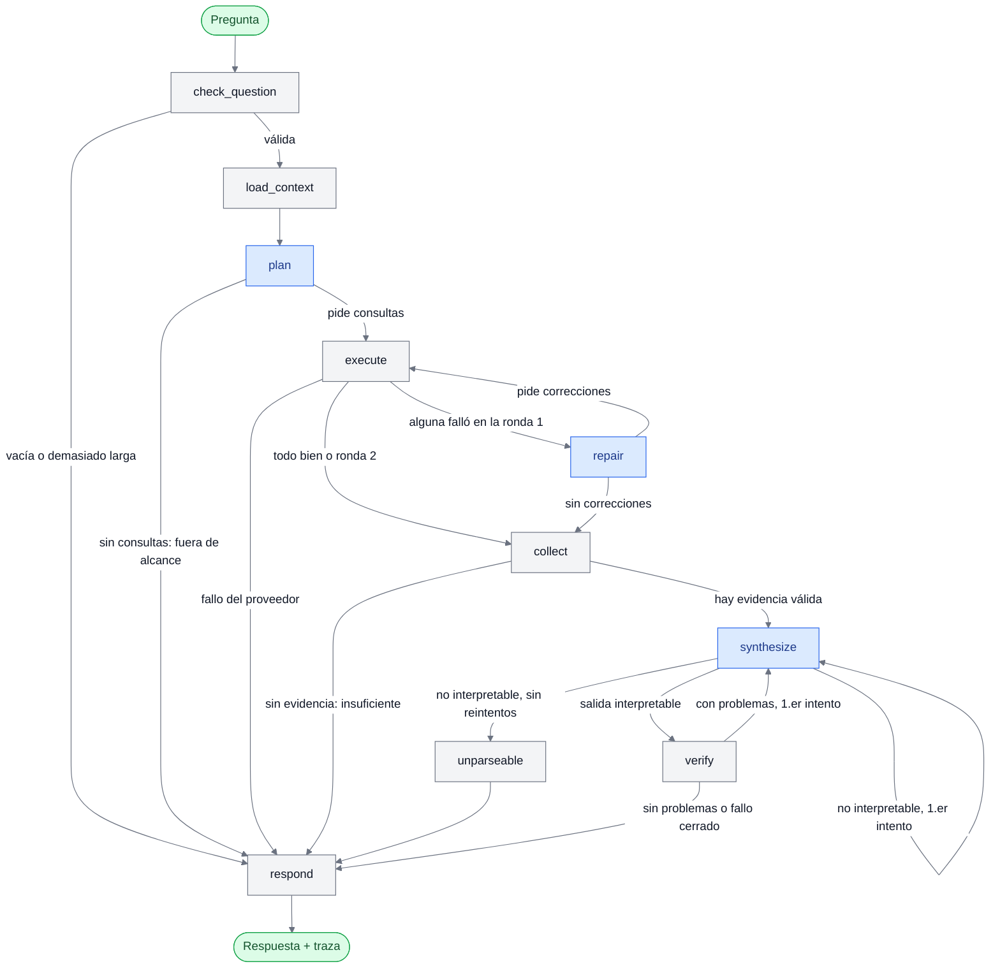

# ai-data-assistant

**Brío Analyst** es un asistente de análisis comercial con IA para el equipo de mercadeo de Almena Foods. La marca Brío muestra señales de deterioro en el primer semestre de 2026, y el asistente ayuda a entender qué pasó sin sacrificar exactitud ni criterio humano.

Un analista pregunta en lenguaje natural y recibe una respuesta separada en **hechos**, **hipótesis**, **contradicciones** e **información insuficiente**. Cada afirmación cita su evidencia: una consulta a la base de ventas, un fragmento de un documento, un contraste o una evaluación causal.

## Descripción del proyecto

### Qué responde

- **Cifras de ventas:** variaciones por región, canal, presentación o marca entre períodos. Por ejemplo, la región con mayor caída de ventas netas entre T1 y T2 de 2026.
- **Consistencia de un documento con los datos:** contrasta cada afirmación de un documento (por ejemplo, la tabla regional del reporte comercial) con las ventas reales y da un veredicto por afirmación: "coincide", "aproximado" o "no coincide"; en rankings y direcciones, "verdadera" o "falsa".
- **Causalidad:** evalúa una afirmación causal (por ejemplo, "las promociones de la competencia causaron la caída") con cinco criterios fijos y da un veredicto: "contradicha", "no sustentada" o "compatible (hipótesis)". Nunca la da por demostrada.
- **Calidad de datos y documentos:** incidencias detectadas al cargar las ventas, y fragmentos citables de la investigación de consumidor, las observaciones de canales y el reporte comercial.

### Principios

- **El LLM nunca calcula cifras.** Todo número sale de código determinista sobre DuckDB, a partir de una capa semántica (`backend/config/semantic_layer.yaml`).
- **Todo se verifica en código antes de responder:** cada cifra debe estar en la evidencia que la afirmación cita; las citas deben ser de esta ejecución; los hechos no pueden usar lenguaje causal; las hipótesis van atenuadas.
- **Los documentos son evidencia, nunca instrucciones.** Su texto llega al LLM delimitado; las instrucciones que contenga se ignoran.
- **Nada hardcodeado:** marca, períodos, regiones y canales son parámetros. Umbrales, límites y léxicos viven en `backend/config/agent.yaml`.

### Fuentes de datos (`data/raw/`)

| Archivo | Contenido |
|---------|-----------|
| `02_Ventas_2026.csv` | Ventas de enero a junio de 2026 (~4.000 registros, con inconsistencias que la ingesta trata y documenta). |
| `01_Contexto_Negocio.md` | Contexto de negocio de Almena Foods. |
| `03_Investigacion_Consumidor.pdf` | Estudio exploratorio de consumidores. |
| `04_Observaciones_Canales.docx` | Observaciones de campo en puntos de venta. |
| `05_Reporte_Comercial.pdf` | Reporte ejecutivo del desempeño de Brío. |

### Componentes

- **Backend** (`backend/src/analyst_backend/`): API FastAPI (`POST /ask`, `GET /health`) y agente LangGraph. El LLM es Gemini (`langchain-google-genai`).
- **Frontend** (`frontend/src/analyst_frontend/`): interfaz Streamlit que consume la API.
- **Datos:** dos bases DuckDB en `data/processed/`. `analytics.duckdb` guarda las ventas limpias, las filas en revisión y las incidencias de calidad. `documents.duckdb` guarda los documentos convertidos a Markdown y fragmentados, con embeddings locales (fastembed).
- **Búsqueda en documentos:** híbrida, con BM25 y embeddings combinados con RRF. Sin el modelo de embeddings funciona solo por palabras y lo avisa.
- **Contenedores:** `make up` levanta backend y frontend con Docker Compose, con los datos del host en solo lectura.

Las decisiones de arquitectura (D1–D10) están en [docs/architecture.md](docs/architecture.md), y las specs vigentes en [openspec/specs/](openspec/specs/).

## Workflow del agente (LangGraph)

El agente sigue la estrategia **plan y ejecución**: el LLM pide en una sola respuesta todas las consultas que necesita; el código las ejecuta y verifica, y el LLM solo redacta la respuesta a partir de la evidencia. Con la cuota gratuita, una pregunta de cifras hace normalmente 2 llamadas al LLM (plan y síntesis) y una de contraste o de causalidad, 3 (además, la extracción dentro de la herramienta). Como mucho son 6.



Los nodos en azul llaman al LLM. Además, `execute` lo llama dentro de `contrastar_afirmaciones` y `evaluar_causalidad`, para la extracción. Si cualquier nodo falla (por ejemplo, la base no existe o se agotó la cuota), el grafo salta a `respond` con estado `error` y un código estable.

### Qué hace cada nodo

| Nodo | Tipo | Qué hace |
|------|------|----------|
| `check_question` | Código | Valida que la pregunta no esté vacía ni supere `max_question_chars` (1.000). Si no es válida, responde con `invalid_question` sin llamar al LLM. |
| `load_context` | Código | Prepara el contexto del plan: el catálogo de la capa semántica (métricas, dimensiones y valores válidos), los documentos cargados y el rango de meses con datos, leído de DuckDB. |
| `plan` | LLM | Con las cinco herramientas enlazadas (`bind_tools`), pide en **una** respuesta todas las consultas. Si no pide ninguna, la pregunta queda fuera de alcance y se responde con un mensaje fijo. |
| `execute` | Código | Ejecuta las consultas de una en una con `ToolNode`. Respeta un máximo por herramienta (5) y uno propio para contraste y causalidad (1). Los errores (valor fuera de catálogo, documento inexistente…) vuelven como mensajes para la corrección. Si el proveedor falla dentro de una herramienta, conserva lo ya ejecutado y termina. |
| `repair` | LLM | Una sola corrección: el LLM solo ve los errores (campo, valor y opciones válidas), nunca el texto de los documentos, y vuelve a pedir las consultas que fallaron. |
| `collect` | Código | Reúne la evidencia citable de las consultas correctas: resultados de métricas y calidad, fragmentos de documentos, contrastes y evaluaciones causales, con sus consultas internas. Sin evidencia válida, responde "insuficiente" sin sintetizar. |
| `synthesize` | LLM | Redacta con salida estructurada los hechos, hipótesis, contradicciones e información insuficiente, cada afirmación con sus citas. La evidencia va delimitada y las reglas se repiten al final. |
| `unparseable` | Código | Si la síntesis no se puede interpretar ni tras el reintento, responde con `invalid_output`. |
| `verify` | Código | Revisa cada afirmación: cifras dentro de la evidencia que cita, citas de esta ejecución, sin lenguaje causal en los hechos (salvo con el veredicto causal citado), hipótesis atenuadas, veredictos iguales a los calculados y "información insuficiente" que no declare ausente lo que se consultó. Si hay problemas, da 1 reintento; si persisten, retira las afirmaciones que fallan (fallo cerrado). |
| `respond` | Código | Arma la respuesta final: estado, apartados, avisos de calidad, evidencias resueltas (con título y resultado completo) y la traza (consultas, llamadas e intentos al LLM, problemas de verificación, modelo y duración). |

### Herramientas del plan

| Herramienta | Qué hace |
|-------------|----------|
| `consultar_metrica` | Métricas de ventas (venta neta, unidades, precio efectivo…) con filtros, agrupación, un período o una comparación entre dos. El SQL lo genera el código desde la capa semántica. |
| `calidad_datos` | Incidencias de calidad detectadas al cargar las ventas, filtrables por dimensión, período y regla. |
| `buscar_documentos` | Fragmentos citables de los documentos, por búsqueda híbrida. |
| `contrastar_afirmaciones` | Extrae con el LLM las afirmaciones de un documento, las valida en código y las compara con los datos, con un veredicto por afirmación. |
| `evaluar_causalidad` | Busca dónde, cuándo y con qué diseño se observó la causa y aplica cinco criterios: localización, grupo de comparación, temporalidad, explicaciones alternativas y diseño de la evidencia. |

## Preparar el entorno con Docker

La aplicación corre en dos contenedores (backend y frontend). La ingesta de datos se ejecuta una vez en el host, y los contenedores montan su resultado en solo lectura.

### Requisitos

- **Docker** con **Compose ≥ 2.24**.
- **GNU Make**.
- **[uv](https://docs.astral.sh/uv/) 0.13.4**, para la ingesta en el host: `curl -LsSf https://astral.sh/uv/0.13.4/install.sh | sh`.
- **Python 3.14**, fijado en `.python-version`. uv lo instala si falta; también vale `pyenv install 3.14`.
- **Una clave de Gemini** de [Google AI Studio](https://aistudio.google.com/). Basta la cuota gratuita.
- Conexión a internet la primera vez, para las dependencias, el modelo de embeddings (~240 MB) y las imágenes de Docker.

### Variables de entorno (`.env`)

```bash
cp .env.example .env
```

Completa en `.env`, que nunca se versiona:

```bash
LLM_PROVIDER=gemini
GEMINI_MODEL=<modelo, por ejemplo uno de la familia Gemini Flash>
GEMINI_API_KEY=<tu clave de Google AI Studio>
```

- **Solo el backend recibe `.env`.** Las rutas de las bases dentro del contenedor las fija `docker-compose.yml`, así que las de `.env` solo afectan a los comandos del host.
- **`BACKEND_TIMEOUT_S`** (opcional): segundos que la interfaz espera la respuesta. Son 300 por defecto.
- **Puertos:** se cambian con `BACKEND_PORT` (8000) y `FRONTEND_PORT` (8501). Se publican solo en `127.0.0.1`, para que nadie más en la red use la API ni tu cuota de Gemini.
- **Comportamiento del agente:** límites del proveedor, razonamiento, topes de consultas, umbrales de contraste y causalidad, y léxicos de la verificación están en `backend/config/agent.yaml`.

## Paso a paso: de la ingesta a la primera pregunta

### 1. Instalar las dependencias

```bash
uv sync --all-packages
```

### 2. Configurar Gemini

```bash
cp .env.example .env      # y completa LLM_PROVIDER, GEMINI_MODEL y GEMINI_API_KEY
```

### 3. Cargar las ventas

```bash
make ingest
```

Lee `data/raw/02_Ventas_2026.csv`, aplica las reglas de calidad (duplicados, valores fuera de catálogo, precios incoherentes…) y publica `data/processed/analytics.duckdb`. Ahí quedan `sales` (única fuente de cifras), `sales_review` (filas retenidas), `dq_issues` (cada incidencia) e `ingestion_runs`. Se reconstruye entera cada vez.

### 4. Descargar el modelo de embeddings

```bash
make models
```

Descarga una sola vez el modelo multilingüe (~240 MB) en `.cache/models` y comprueba su huella SHA-256.

### 5. Cargar los documentos

```bash
make ingest-docs
```

Convierte a Markdown el PDF, el Word y el Markdown de `data/raw/`, los fragmenta por sección y por ID de evidencia (`REP-01`, `INV-04`, `OC-CEN-02`…), calcula los embeddings y publica `data/processed/documents.duckdb`.

### 6. Levantar la aplicación

```bash
make up
```

- **Comprobación previa:** `make up-check` verifica que existen las dos bases y el modelo. Si falta algo, dice qué comando ejecutar.
- **Primera vez:** construye las imágenes.
- **Servicios:**
  - backend en http://localhost:8000; `GET /health` responde aunque falten datos o credenciales;
  - frontend en http://localhost:8501.
- **Primer plano:** se detiene con `Ctrl+C` (o `docker compose down` desde otra terminal).
- **Cambios en `.env`:** vuelve a ejecutar `make up` para recrear el contenedor.

### 7. Preguntar desde la interfaz de Streamlit

1. Abre **http://localhost:8501**.
2. Escribe la pregunta en el cuadro inferior. Por ejemplo:
   - ¿Cuál fue la región con mayor caída porcentual en ventas netas de Brío entre T1 y T2 de 2026?
   - ¿Son consistentes las principales conclusiones del reporte comercial con los datos de ventas?
   - ¿Podemos afirmar que las promociones de la competencia causaron la caída de ventas? ¿Qué evidencia lo sustenta o limita?
3. Espera la respuesta. Una pregunta de cifras tarda unos segundos; una de contraste o de causalidad, entre 30 y 45 s. El cuadro se bloquea mientras tanto, porque la API responde las preguntas de una en una.
4. Lee la respuesta por apartados: **Hechos**, **Hipótesis**, **Contradicciones** e **Información insuficiente**.
5. Despliega cada cita para ver su evidencia:
   - **Consulta de métricas:** la tabla con los valores.
   - **Fragmento:** el texto con su documento y página.
   - **Contraste:** la tabla de afirmaciones (reportado, real, diferencia, veredicto) y, aparte, las descartadas con su motivo.
   - **Evaluación causal:** la causa, el veredicto y los cinco criterios.
6. Revisa al final los **avisos sobre los datos** y la **traza**: consultas ejecutadas, llamadas al LLM y duración.

El historial es solo de la sesión del navegador: cada pregunta se responde de forma independiente.

### Problemas frecuentes

| Síntoma | Causa y solución |
|---------|------------------|
| `make up` dice que falta una base o el modelo | Ejecuta el paso que nombra: `make ingest`, `make ingest-docs` o `make models`. |
| "Se agotó la cuota del LLM" | Límite de la cuota gratuita de Gemini. Espera un minuto y vuelve a preguntar. |
| "La configuración del backend no es válida" | Falta o es incorrecta una variable de `.env`. Corrígela y ejecuta `make up` de nuevo. |
| "La API no respondió a tiempo" | La pregunta superó `BACKEND_TIMEOUT_S`. Puede seguir en curso en la API: espera antes de repetirla. |
| Una respuesta "insuficiente" | No hubo evidencia válida para responder. Revisa en la traza qué consultas fallaron y reformula la pregunta. |

## Referencia

### Comandos

| Comando | Qué hace |
|---------|----------|
| `make help` | Lista los objetivos disponibles. |
| `make ingest` | Carga el CSV de ventas en `data/processed/analytics.duckdb` con las reglas de calidad. Rutas configurables con `SALES_CSV_PATH`, `DUCKDB_PATH`, `SEMANTIC_LAYER_PATH` y `DATA_QUALITY_PATH`. |
| `make models` | Descarga el modelo de embeddings en `MODELS_CACHE_DIR` (`.cache/models`) y comprueba su huella. |
| `make ingest-docs` | Publica `data/processed/documents.duckdb` con los documentos fragmentados y sus embeddings. Rutas configurables con `DOCUMENTS_DIR`, `DOCUMENTS_DB_PATH`, `DOCUMENTS_CONFIG_PATH` y `MODELS_CACHE_DIR`. |
| `make up` | Comprueba las bases y el modelo y levanta backend (`:8000`) y frontend (`:8501`) en `127.0.0.1`. Otros directorios de datos: `make up DOCKER_DATA_DIR=... DOCKER_MODELS_DIR=...`. |
| `make up-check` | Solo la comprobación previa de `make up`. |
| `make ask Q="<pregunta>"` | Responde una pregunta desde la terminal, sin Docker. Termina con código 1 si falta configuración y 2 si la respuesta tiene estado `error`. |
| `make test` | Pruebas sin LLM, modelo de embeddings, red ni credenciales. |
| `make test-embeddings` | Pruebas con el modelo de embeddings real, sin red (requiere `make models`). |
| `make test-llm` | Pruebas con Gemini (requieren red y `.env`). `LLM_TESTS` limita las rutas. |
| `make eval` | Evaluación con el golden set (pendiente del change `add-evaluation-suite`). |

### Notas sobre los contenedores

- **Montajes:** compose monta `data/processed` y `.cache/models` en solo lectura. Las bases deben llamarse `analytics.duckdb` y `documents.duckdb`. El contenedor las lee con el uid 1000, así que deben ser legibles para ese usuario.
- **Recargas:** si ejecutas `make ingest` con la aplicación en marcha, la siguiente pregunta ya usa los datos nuevos.
- **Sin Docker:** `uv run --all-packages uvicorn analyst_backend.main:app --reload` (backend) y `uv run --all-packages analyst-frontend` (frontend).

### Usar la API directamente

```bash
curl -s -X POST http://localhost:8000/ask -H 'Content-Type: application/json' \
  -d '{"question": "¿Cuál fue la región con mayor caída porcentual en ventas netas de Brío entre T1 y T2 de 2026?"}'
```

Devuelve en JSON `status`, `error_code`, `message`, `facts`, `hypotheses`, `contradictions`, `insufficient`, `warnings`, `evidence` y `trace`. El estado HTTP sigue al resultado:

| Estado | Cuándo |
|--------|--------|
| 200 | Hay respuesta. |
| 422 | Pregunta vacía o petición inválida (solo admite `question`). |
| 429 | Se agotó la cuota. |
| 503 | Faltan datos o configuración. |
| 502 o 504 | Fallo del proveedor. |
| 500 | Error interno. |

### Consultar las herramientas desde Python

Tras `make ingest`, `consultar_metrica` se puede probar directamente:

```bash
DUCKDB_PATH=data/processed/analytics.duckdb SEMANTIC_LAYER_PATH=backend/config/semantic_layer.yaml \
uv run --all-packages python -c '
from analyst_backend.analytics.metrics import consultar_metrica
from analyst_backend.analytics.models import MetricQuery
from analyst_backend.analytics.semantic import load_semantic_layer
from analyst_backend.settings import load_analytics_settings

settings = load_analytics_settings()
layer = load_semantic_layer(settings.semantic_layer_path)
query = MetricQuery(
    metrics=["venta_neta"], filters={"marca": ["Brío"]}, group_by=["region"],
    compare={"base": "2026-T1", "target": "2026-T2"},
    sort={"metric": "venta_neta", "field": "var_pct", "order": "asc"},
)
result = consultar_metrica(query, layer, settings.duckdb_path)
for row in result.rows:
    cell = row.metrics["venta_neta"]
    print(row.rank, row.group["region"], cell.base, cell.target, cell.var_pct)
print(result.evidence_id, [(n.registro_id, n.rule_code) for n in result.quality_notes])
'
```

Tras `make models` y `make ingest-docs`, `buscar_documentos` devuelve los fragmentos más pertinentes:

```bash
DOCUMENTS_DIR=data/raw DOCUMENTS_DB_PATH=data/processed/documents.duckdb \
DOCUMENTS_CONFIG_PATH=backend/config/documents.yaml MODELS_CACHE_DIR=.cache/models \
uv run --all-packages python -c '
from analyst_backend.documents.config import load_documents_config
from analyst_backend.documents.embeddings import FastEmbedEmbedder
from analyst_backend.documents.models import DocumentQuery
from analyst_backend.documents.retrieval import buscar_documentos
from analyst_backend.settings import load_documents_settings

settings = load_documents_settings()
config = load_documents_config(settings.documents_config_path)
embedder = FastEmbedEmbedder(config.model, settings.models_cache_dir)
query = DocumentQuery.model_validate({"query": "faltantes de Brío en Sur", "top_k": 3}, context={"config": config})
result = buscar_documentos(query, config, settings.documents_db_path, embedder)
for hit in result.hits:
    print(hit.rank, hit.primary_evidence_id or hit.chunk_id, hit.doc_id, hit.page, hit.text[:70])
print(result.mode, result.evidence_id, [w.code for w in result.warnings])
'
```

### Estructura del repositorio

- `backend/src/analyst_backend/`: API, agente (`agent/`), lógica de análisis (`analytics/`), documentos (`documents/`) e ingesta (`ingestion/`).
- `backend/config/`: `semantic_layer.yaml`, `data_quality.yaml`, `documents.yaml` y `agent.yaml`.
- `frontend/src/analyst_frontend/`: interfaz Streamlit.
- `backend/tests/`, `frontend/tests/`, `tests/`: pruebas de cada aplicación y del repositorio.
- `openspec/`: specs vigentes (`specs/`) y changes (`changes/`) del desarrollo guiado por specs.
- `docs/`: arquitectura y exploración de los datos.
